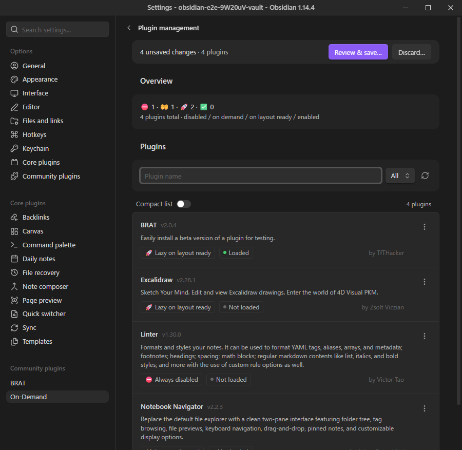
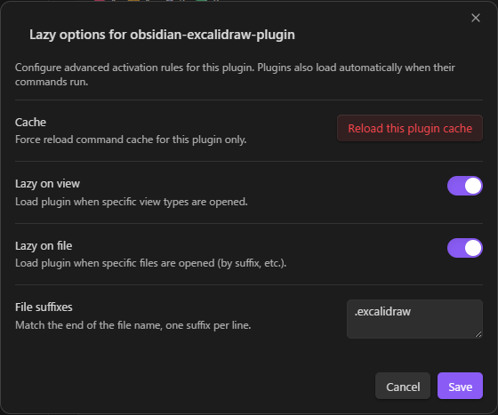

# On-Demand Plugins

Obsidian plugin that delays plugin activation and only loads plugins when needed, improving startup performance.

---

## How to use

1. Open **Settings → On-Demand Plugins**.
2. Choose a loading mode for each plugin.
3. Click **Apply changes** (Obsidian will restart automatically).

### Plugin table

For many plugins at once, run **Open plugin table** from the command palette, or click **Open table** in **Plugin management**. The table can be searched, sorted, filtered by column and resized, and changes only loading modes: pick a mode in the **Mode** column, and use the gear to its right for the lazy options of **Lazy on demand** plugins. Right-click a row, or a selection of rows, for more actions; on phones and tablets each row has a menu button instead. The **Enabled** column shows whether a plugin is loaded right now; plugins are switched on and off only through their mode. The table and the settings share one draft, so **Review & save…** at the right of the table's bar saves the same changes.

To refresh cached commands and view types together, open **Maintenance → Rebuild command and view caches** and click **Rebuild caches**. View types are refreshed for lazy plugins with **lazy on view** enabled. Each plugin is loaded once, with up to three plugins initializing concurrently; plugins loaded only for rebuilding are unloaded afterwards. Obsidian restarts when the rebuild completes.

---

## Loading modes

| Mode                     | Description                                                                                                                                                                                                                                                                                        |
| ------------------------ | -------------------------------------------------------------------------------------------------------------------------------------------------------------------------------------------------------------------------------------------------------------------------------------------------- |
| **Lazy on demand**       | Loads when a command is executed, a specified view type is opened, or when a specific file is opened. In the settings modal you can separately enable `lazy on file` and `lazy on view`. View types are automatically collected when you click **Apply changes**, so manual entry is not required. |
| **Lazy on layout ready** | Loads after the workspace layout is ready.                                                                                                                                                                                                                                                         |
| **Always enabled**       | Loads at startup as normal.                                                                                                                                                                                                                                                                        |
| **Always disabled**      | Keeps the plugin disabled.                                                                                                                                                                                                                                                                         |

> When **Lazy on demand** is selected you can configure `lazy on file` and `lazy on view` individually in the modal. View types are auto-detected on **Apply changes**.

---

## Notes

- Plugins that use `setInterval` / `setTimeout` or register global hooks (for example, `vault.on`) should be set to **Lazy on layout ready**. If set to **Lazy on demand**, such plugins will not run their background tasks or hooks until they are loaded.
- Inline/embedded views (for example, Dataview inline queries) are not supported.

### Backups

When settings change, `.obsidian/community-plugins.json` is updated automatically. Up to three generations of backups are created; please keep your own backups as well.

If `community-plugins.json` is changed outside On-Demand Plugins (by Sync, Git, a manual edit, the Obsidian CLI or another plugin), a notice appears at startup, and applying changes asks before overwriting those edits. To keep them instead, use **Maintenance › Sync settings** to copy them into the On-Demand settings. Syncing **Plugin data → Obsidian config** shows what changes, asks first, and restarts Obsidian to apply it.

Entries for plugins that are not installed on this device, or desktop-only plugins on mobile, are kept as they are, so a device that shares `community-plugins.json` through Sync never disables another device's plugins.

### Unsaved changes

Mode changes stay a draft until you click **Review & save…**. Moving between On-Demand's settings pages keeps the draft. If you close settings or switch to another settings tab, the draft is set aside and On-Demand keeps running on the saved settings. The plugin table shares the draft, so it is set aside only once both settings and the table are closed. When you return to **Plugin management**, **Maintenance & batch** or the plugin table, it offers the draft back (**Restore** or **Discard**). **Behaviour › Unsaved draft prompt** (shared by all profiles) can restore or discard it automatically instead. A set-aside draft lasts until Obsidian restarts.

### How it works

Instead of loading the plugin code at startup, this project registers "dummy commands" that cache command metadata. The actual plugin is loaded only when its command or a configured view/file is used. Internally it monkey-patches parts of Obsidian's core, so updates to Obsidian may break behavior.

---

This project is based on the work by Alan Grainger: https://github.com/alangrainger/obsidian-lazy-plugins

## Test coverage

```bash
pnpm run test:coverage
pnpm run test:e2e:coverage
pnpm run test:coverage:all
```

Unit tests use `@vitest/coverage-v8`. E2E tests use the toolkit's `coverageOptions` fixture and coverage report API to collect V8 coverage from the Obsidian renderer before plugins are enabled. CI runs E2E on Windows and macOS, using the same parallel/serial split as `test:e2e`. Headless Linux needs Xvfb and Electron's OS dependencies.

Local E2E and ordinary CI share the Obsidian desktop version in `tests/obsidian-version.txt`. Setup downloads pinned Obsidian and plugin assets directly from public releases without GitHub API lookups. Set `OBSIDIAN_E2E_TOOLKIT_OBSIDIAN_VERSION` to override the version; scheduled CI checks the latest desktop release. Runtime assets are prepared by E2E setup, while the toolkit prepares Electron at launch.

Open `coverage/unit/index.html` or `coverage/e2e/index.html` for the separate HTML reports. `test:coverage:all` runs both suites and merges their results into `coverage/combined/index.html`. Each report also includes `lcov.info` and `coverage-final.json`. Reports exclude tests, mocks, declarations, and dependencies. E2E reports cover source files included in the plugin bundle and map them back to TypeScript through inline source maps. The coverage command restores the normal production bundle afterwards.

Both `test:e2e` and `test:e2e:coverage` preserve the parallel and serial phases separately under `test-results/` and `blob-report/`. The combined HTML report is `playwright-report/index.html`, with machine-readable results in `playwright-report/results.json`. A failure in either phase still fails the command, and CI uploads both phases' diagnostics.

To merge existing results from the same source revision without rerunning tests, use `pnpm run test:coverage:merge`.

To measure a specific E2E suite:

```bash
pnpm run test:e2e:coverage tests/on-demand.spec.ts
```

## Screenshots

<!-- Screenshot: On-Demand Plugins settings -->

*On‑Demand Plugins settings page.*

<!-- Screenshot: On-Demand Modal -->

*Settings modal.*
